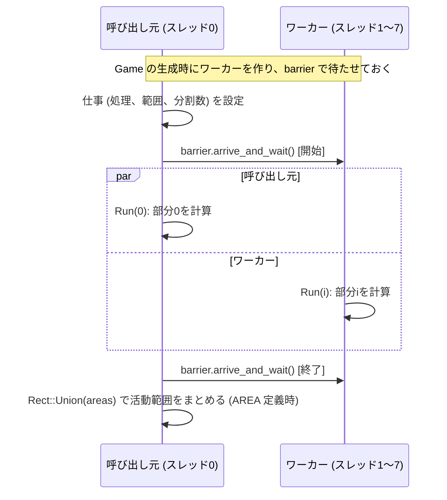

# C++/Win32で学ぶ高速ライフゲーム実装


- [実行のイメージ | YouTube](https://youtu.be/ny-VKZEAVkg)

## はじめに
[ライフゲーム](https://ja.wikipedia.org/wiki/%E3%83%A9%E3%82%A4%E3%83%95%E3%82%B2%E3%83%BC%E3%83%A0)は、ルール自体は驚くほど簡単なのに、実装に入った瞬間に「なぜこんなに遅いのか」という現実に直面する題材である。  
同じ盤面、同じルールでも、データの持ち方やループの回し方、描画への渡し方が変わるだけで体感速度は大きく変わる。  
本記事は筆者がGitHubにあげた[Shos.LifeGame](https://github.com/Fujiwo/Shos.LifeGame) を題材に、実装を読む順番そのものを道しるべにしながら、どこで時間を使い、どこで短縮しているのかを追う。結論だけ先に言えば、この実装の核心は `USEBITS` / `FAST` / `MT` / `AREA` という4つの高速化要素と、`BoardPainter` による描画最適化が、別々のボトルネックに効くように配置されている点にある。

- この記事で持ち帰れるポイント:
  1. 様々な最適化方法とその効果
  2. 実行速度とそれ以外のトレードオフ
- 対象読者:
  - C++初級後半〜中級(`std::thread` と前処理マクロの基本を理解している読者)
- 実際のソースコード:
  - [Shos.LifeGame | GitHub](https://github.com/Fujiwo/Shos.LifeGame)


まずはライフゲームの実行画面のイメージをつかんでほしい。

#### 図1: 世代更新と描画を繰り返しながら、パターンが時間発展する様子を示す
</img>
※ 実際の実行画面とは異なる

### 最適化の結果

結果を先に述べておくと、Shos.LifeGame で行った最適化により次のように高速化することができた:

| 最適化 | 世代/秒 | 世代/秒の倍率 |
|----| ----:| ----:|
| 前 | 16  | 1.00 |
| 後 | 244 | 15.25 |

| 測定条件 | |
|----|----|
| パターン | `Gun_Gunstar` |
| 盤面サイズ | `1000x1000 (1,000,000セル)` |
| 世代数 | `1000` 世代 |

| 測定環境 | |
|----|----|
| PC | DELL ノートPC XPS 13 9310 |
| メモリー | 16GB |
| CPU | 11th Gen Intel Core i7 2.92GHz 4コア (8論理プロセッサー) |
| GPU | Intel Iris Xe グラフィックス |
| OS | Windows 11 |

※ この値は、2026年10月の高速化の作業 (5章) より前のコードで測ったものである。現在のコードでの値は測り直す必要がある (6.4節)。

---

## 1. ライフゲームとは何か

### 1.1 概要

ライフゲーム(Conway's Game of Life)は、1970年にイギリスの数学者ジョン・ホートン・コンウェイが考案した、生命の誕生や淘汰を簡易的なモデルで再現したシミュレーションゲームである。

- **特徴**
  - **ゼロプレイヤーゲーム**: プレイヤーが操作するのではなく、最初にセルの配置(初期状態)を決めた後は、特定のルールに従って自動的に変化が進む様子を観察する
  - **セルオートマトン**: 格子状のセル(細胞)が「生」か「死」の状態を持ち、周囲の状況に応じて次の世代の状態が決定される

- **基本ルール**:
あるセルの次の世代の状態は、その周囲8マスの「生きているセル」の数によって決まる

  - **誕生**: 死んでいるセルの周囲に、生きているセルがちょうど 3個 あると、次世代で「誕生」する
  - **生存**: 生きているセルの周囲に、生きているセルが 2個または3個 あると、次世代でも「生存」する
  - **過疎**: 生きているセルの周囲に、生きているセルが 1個以下しかないと、寂しさ(過疎)で「死滅」する
  - **過密**: 生きているセルの周囲に、生きているセルが 4個以上 あると、混みすぎ(過密)で「死滅」する 

**図2. ライフゲームの更新ルール(3x3近傍)**  
中心セルの次状態は8近傍の生セル数で決まり、誕生と生存の条件が分かれる。
</img>

- **パターン**
この単純なルールに基づいてセルを初期配置すると、時間の経過とともにさまざまな形や動きを見せるパターンが現れてくることがある。
  - **固定物体**: 形が全く変わらず静止し続けるもの
  - **振動子**: 一定の周期で形を変化させながらその場に留まるもの(例:ブリンカー)
  - **移動物体**: パターンを繰り返しながら画面上を移動していくもの(例:グライダー)

プログラミングの課題としても非常に人気がある。

実装側で行うことも本質的には単純で、「毎世代この判定を盤面全体に適用し、次世代の状態へ置き換える」というのを繰り返すだけである。

### 1.2 なぜ実装で差が出るのか
性能差が生まれる理由は、同じ計算をしていても「どんな形でメモリに置き」「どんな順で読み書きし」「どこまでを処理対象にするか」が実装ごとに違うからである。  
`Shos.LifeGame` では、bit表現とbool表現の切替、汎用反復と直接ループの切替、並列化、活動領域限定、さらに描画最適化までを段階的に分離している。

この分離があるおかげで、「速いか遅いか」だけでなく「何が効いたのか」を追跡できる。次章では、その追跡を迷わず進めるために、まず実装全体の地図を作る。

---

## 2. Shos.LifeGameの全体像
`Shos.LifeGame` では、主要ロジックが `ShosLifeGame.h` にまとまっていて、全体像が掴みやすいようになっている。
役割の中心には `Game` があり、世代更新の進行と盤面管理を担当する。盤面そのものは `Board` と `BitCellSet` が持ち、入力は `PatternSet` が `.lif` / `.rle` から読み込み、最後の表示を `BoardPainter` が担当する。
実行時には `MainWindow::Next` が1ステップの起点となり、`game.Next()` で盤面を進めた直後に再描画を要求し、世代数とFPS (ここでは1秒当たりの世代数) をタイトルへ反映する。タイトルの更新は、0.1秒に1回に間引いている。
この「入力→更新→描画」の流れを先に頭へ入れておくと、後続の章で個別最適化を見たときに、どの層に作用している変更なのかを即座に判断できる。

#### 図3: 主要クラスの関係
`MainWindow` が更新を駆動し、`Game` が盤面状態を管理、`BoardPainter` が描画を担当する。
</img>

---

## 3. パターンファイル形式とCellDataの読み解き
### 3.1 [`.lif`(Life 1.05)形式](https://conwaylife.com/wiki/Life_1.05)
`.lif` は、見た目に近い形でセル配置を行テキストとして持つ形式である。`Shos.LifeGame` の実装では、まず `#` で始まる行と `!` で始まるコメント行を取り除き、次に行幅を揃えてから、生セル `*` と死セル `.` の内部表現へ連結する。`#P x y` があれば、続く行をその位置のブロックとして配置する。ブロックの途中の空行は「すべて死セルの行」として扱う。  
この手順の利点は、ファイルを目で追いやすい点にある。形式が素直なので、パターンの意図を理解しながらデータ化できるのが `.lif` の強みである。

例. Gosper glider gun
```
........................O
......................O.O
............OO......OO............OO
...........O...O....OO............OO
OO........O.....O...OO
OO........O...O.OO....O.O
..........O.....O.......O
...........O...O
............OO
```

### 3.2 [`.rle`(Run Length Encoding)形式](https://conwaylife.com/wiki/Run_Length_Encoded)
`.rle` は、同じ状態が続く区間を圧縮して書く形式である。実装側では最初にヘッダ(`x=...`, `y=...`)からサイズを取り出し、その後に本文の `b` / `o` / `$` / `!` を展開して盤面データへ戻す。  
人間にとってはやや記号的だが、大きなパターンをコンパクトに扱えるため、配布や共有の実用性が高い形式である。

例. Gosper glider gun
```
x = 36, y = 9, rule = B3/S23
24bo11b$22bobo11b$12b2o6b2o12b2o$11bo3bo4b2o12b2o$2o8bo5bo3b2o14b$2o8b
o3bob2o4bobo11b$10bo5bo7bo11b$11bo3bo20b$12b2o!
```

#### 図4: `.lif` と `.rle` の表現対応**
同じセル形状でも、`.lif` は行テキスト、`.rle` は連長圧縮で記述される。
</img>

### 3.3 `CellData` 同梱パターンの使い分け
`CellData` の価値は、単なるサンプル集ではなく、読み手が負荷特性の違いを追体験できる教材になっている点にある。たとえば `Spaceship_Glider.lif` を見ると、局所的な変化が盤面を移動する様子が分かる。そこから `Gun_GosperGliderGun.lif` へ進むと、継続的に構造が放出されるため、更新対象が時間とともに広がっていく。さらに `OTCA_metapixel.rle` のような大規模パターンでは、更新・描画ともに重くなる条件が明確になり、どの最適化が効きやすいかを考える足場ができる。  
以下の表は、その学習順序を崩さずにパターンを選ぶためのガイドとして使える。
あわせて図5を見ると、カテゴリ同士の位置関係と用途の違いを直感的につかめる。

| カテゴリ | 代表例 | 使いどころ |
|---|---|---|
| [Gun](https://conwaylife.com/wiki/Gosper_glider_gun) | [`Gun_GosperGliderGun.lif`](https://conwaylife.com/patterns/gosperglidergun.cells) | 長期的に発生し続ける挙動の例 |
| Oscillator | `Oscillator_Pulsar.lif` | 周期運動の理解 |
| Spaceship | `Spaceship_Glider.lif` | 移動パターンと領域追跡の説明 |
| Methuselah | `Methuselah_Acorn.lif` | 初期単純・長期複雑化の例 |
| Puffer / Engine | `Puffer_Puffer1.lif` | 広範囲に変化する高負荷ケース |
| Breeder / Meta | `Breeder1.lif`, `OTCA_metapixel.rle` | 大規模化・自己増殖系の話題 |

#### 図5: `CellData` パターン分類マップ
Gun/Oscillator/Spaceship などのカテゴリで、用途に応じたパターン選定を行える。
</img>


---

## 4. データ構造と更新処理の基礎
### 4.1 `Board` と `BitCellSet`
`USEBITS` を有効化した構成では、`Board` は `BitCellSet` を継承して1bit/セルで盤面を保持する。これによりメモリ効率が高く、後段の描画処理へビット列を渡しやすくなる。  
一方で `USEBITS` を無効(未定義)にすると、行ごとの `bool` 配列 (`std::vector<std::unique_ptr<bool[]>>`) を使う別実装へ切り替わる。こちらは理解しやすさに利点があるが、表現密度や変換コストの観点ではトレードオフが生まれる。

### 4.2 `Game::Next` と `Game::NextPart`
世代更新の入口は `Game::Next` で、ここから実際の更新処理が `NextPart` へ流れる。`MT` を定義するとY方向に分割して並列実行され、`AREA` を定義すると活動領域に処理対象を絞り込み、`FAST` を定義すると直接ループと行単位の計算 (`Game::NextRow`) で反復コストを抑える。  
つまりこの層では、「何を計算するか」は同じでも「どう計算を配るか」を切り替えている、という理解が重要である。

### 4.3 `BoardPainter` による描画
描画段では、`Board::GetBits()` で得た盤面ビット列を `SetBitmapBits` で使い回しのビットマップへ写し、最終的に `BitBlt` で画面へ転送する。  
この構成のポイントは、更新ロジックと描画ロジックを分離しながら、データ表現をできるだけ中間変換なしで橋渡ししていることにある。更新で作った情報がそのまま描画へ流れるため、処理全体を一本のパイプラインとして捉えやすくなる。次章では、このパイプラインのどこを4要素と描画最適化で改善しているかを個別に分解する。
図6で更新パイプライン全体を確認し、図7でそのうち描画経路だけを拡大して読むと、処理の層を分離して理解しやすい。

#### 図6: 更新パイプライン
`MainWindow::Next` から `Game::Next` を経由して、最終的に `BoardPainter::Paint` で表示される。
</img>

#### 図7: 盤面ビット列からBitmap描画への変換
`Board::GetBits()` の出力をBitmapに渡し、`BitBlt` で画面転送する流れを示す。
</img>

---

## 5. 高速化テクニック4要素と描画最適化の実装読解
第4章で見た更新パイプラインに、4要素と描画最適化を1つずつ重ねていく。最初に押さえておきたいのは、要素ごとに効く場所が違うという点だ。ある要素が大きく効く条件で、別の要素はほとんど効かない、ということも普通に起こる。
先に全体像を1表で置いておく。`BoardPainter` は描画最適化として別枠で扱う。

| 要素 | 内容 | 主に効く場所 | 効きやすい条件 | 主な副作用 |
|---|---|---|---|---|
| USEBITS | セルを1bitで保持 | メモリー量/描画 | 描画を含めて速くしたい場合 | 計算ではビットの読み書きの手間が増える。未定義時は描画のたびに変換が要る |
| FAST | 直接ループと行単位の計算 | 次世代の計算 | ほぼすべての条件 | コード重複が増える |
| MT | 行をスレッドに分割 | 次世代の計算 | 大盤面・多コア環境 | 同期のコスト・環境依存 |
| AREA | 計算範囲を活動範囲に限定 | 計算範囲 | 疎なパターン | 範囲の管理が複雑化 |

各要素は、次の6項目の順で読んでいく。

- (a) 解決する問題: 最適化しない場合に、どこで何が遅いのか
- (b) 考え方
- (c) 実装: 該当する関数と、要点だけを抜き出したコード
- (d) 効果: 計測値と、その計測の条件
- (e) 代償と、効果が小さくなる条件
- (f) 他の要素との組み合わせによる違い

※ この章では、条件の違う2種類の数値を使う。両者を直接比べてはいけない。
- **Windows の FPS**: 6章の表と図10の値で、アプリのタイトルバーに出る1秒当たりの世代数である。描画の時間を含む。2026年10月の高速化の作業 (後述) より前のコードで測った。
- **WSL での `Game::Next` の時間**: 1世代当たりのミリ秒で、描画を含まない。`Shos.LifeGame.Test/run_benchmark.sh` で測った (WSL2、g++ 13.3、`-O2 -DNDEBUG`、8スレッド、盤面 1000x1000)。「着手前」は高速化の作業の前、「完了後」は現在のコードである。WSL は Windows 側の負荷の影響を受けるので、±20% 程度の誤差を見込んでほしい。経緯と全データはリポジトリの `Plans/2026-10-14_SpeedupPlan.md` にある。

### 5.1 USEBITS (ビット演算とビットパターン転送による描画)
**(a) 解決する問題**  
`USEBITS` が未定義の場合、`Board` は1セルを1つの `bool` で持つ。`bool` は1バイトなので、1000x1000 の盤面は 1,000,000 バイトになり、`Game` はこれを2枚持つ。
しかも `bool` の並びは、そのままでは画面に描けない。そこで `Board::GetBits` が、描画のたびに 1,000,000 セルすべてを `BitCellSet` へ写している。毎フレーム、盤面を丸ごと変換しているわけだ。

**(b) 考え方**  
1セルを1ビットで持つ。さらにビットの並びを、モノクロ (1bpp) ビットマップの形式に合わせる。こうしておけば、変換せずにそのまま描画へ渡せる。
決まりは2つだけである。各バイトの最上位ビット (MSB) を左端のセルにすること、そして各行を新しいバイトから始めて、1行のバイト数を WORD (2バイト) 境界に揃えることだ。

```
x      :  0  1  2  3  4  5  6  7 |  8  9 10 11 12 13 14 15 | ... | 992 ... 999 | (詰め物)
バイト :  ----- バイト 0 ------- |  ----- バイト 1 ------- | ... | バイト 124  | バイト 125
ビット :  7  6  5  4  3  2  1  0 |  7  6  5  4  3  2  1  0 | ... |  7  ...  0  | (未使用)
```

1000セルの行は125バイトに収まり、WORD 境界に揃えて126バイトになる。盤面1枚は 126,000 バイトで、`bool` の盤面の約1/8 だ。

**(c) 実装**  
座標をバイトとビットの位置に変えるのが `BitCellSet::ToIndex`、1行のバイト数を返すのが `BitCellSet::GetRowByteNumber` である (C++20)。

```cpp
static constexpr UnsignedInteger GetRowByteNumber(Integer width)
{ return UnsignedInteger((width + 15) / 16 * 2); }

bool ToIndex(const Point& point, UnsignedInteger& index, Byte& bit) const
{
    if (!GetRect().IsIn(point))
        return false;

    // The leftmost pixel is the most significant bit in a monochrome bitmap.
    // Each row starts at its own byte, so that threads computing different rows never write the same byte.
    constexpr auto bitNumber = sizeof(UnitInteger) * 8;
    index                    = UnsignedInteger(unitNumberX * point.y + point.x / bitNumber);
    bit                      = Byte(bitNumber - 1 - point.x % bitNumber);
    return true;
}
```

`USEBITS` を定義すると、`Board` は `BitCellSet` を継承し、`GetBits()` はビット列をそのまま返す。未定義の場合の `Board` は、`bool` の行のほかに、描画のためだけの `BitCellSet` を1つ持っている。

**(d) 効果**  
- Windows の FPS: Level 0→1 で 16→17 (1.06倍)
- WSL の `Game::Next` (完了後、`FAST` 定義): Random は `bool` で 4.951ms、ビットで 8.013ms。Gun_Gunstar は `bool` で 1.201ms、ビットで 3.571ms

意外に思われるかもしれないが、計算だけを比べると、ビットのほうが遅い。

**(e) 代償と、効果が小さくなる条件**  
なぜビットのほうが遅いのか。ビットのセルは、1つ読むたびにシフトとマスクが要り、1つ書くにはバイトの読み出しと書き戻しが要るからだ。
`USEBITS` の利点は、計算の速さとは別のところにある。メモリーが約1/8 になることと、描画の前の変換がなくなることだ。WSL のベンチマークは描画を含まないので、この利点は数値に表れない。高速化の作業の後で、計算と描画を合わせて `USEBITS` のほうが速いかどうかは、Windows で測り直す必要がある。

**(f) 他の要素との組み合わせ**  
- `FAST` と組み合わせると、`BitCellSet::RowWriter` が8セル (1バイト) ずつまとめて書き込み、`BitCellSet::ClearRow` がバイト単位で消す。
- `MT` と組み合わせると、「各行が新しいバイトから始まる」ことが効いてくる。別々の行を計算する2つのスレッドが、同じバイトに書き込むことはない。
- 描画では、`BoardPainter` がビット列をそのまま `SetBitmapBits` に渡す (5.5節)。

### 5.2 FAST (直接ループ)
**(a) 解決する問題**  
`FAST` が未定義の側のループは、あえて `std::function` で書いてある。`Utility::ForEach` は、盤面のセルごとに `std::function` 経由で処理を呼ぶ。そのセルごとに `GetAliveNeighborCount` が `Utility::Count` を呼び、周囲の9セルそれぞれについて、さらに別の `std::function` を呼ぶ。`Get()` は毎回、座標が盤面の中かを確かめる。
数えると、1セル当たり約10回の間接呼び出しと、9回の範囲チェック、9回の読み出しになる。

**(b) 考え方**  
`FAST` は直接ループを使い、さらに次の世代を行単位で計算する。
ルールの判定には、各セルの周囲3x3の生セルの数が要る。ここで、隣り合う2つのセルの3x3を重ねてみてほしい。3列のうち2列が共通である。そこで、縦3セルの合計 (列和) を1回だけ計算し、3つのセルで使い回す。

```
            x-1  x   x+1 x+2
  行 y-1     a   b    c   d
  行 y       e   f    g   h
  行 y+1     i   j    k   l
            --- ---  --- ---
  列和       L   C    R   R'

セル x   : 合計 = L + C + R
セル x+1 : 合計 = C + R + R'   ← C と R は使い回し。新しく計算するのは R' だけ
```

この合計にはセル自身も入っている。そのため B3/S23 のルールは、「合計が3なら生、合計が4でセル自身が生なら生」と書き直せる。1セルごとに読むのは、新しい列の3セルと、合計が4のときのセル自身だけになる。

書き込みも行単位で行う。`USEBITS` を定義した構成では、8セル分をレジスターに集め、1バイトをまとめて書き込む。

**(c) 実装**  
1行を計算するのが `Game::NextRow` である。次の抜粋では、活動範囲の更新を省いた。

```cpp
const auto upperRow  = std::as_const(*mainBoard).GetRow(y - 1);
const auto row       = std::as_const(*mainBoard).GetRow(y    );
const auto lowerRow  = std::as_const(*mainBoard).GetRow(y + 1);
const auto columnSum = [&](Integer x) {
    return UnsignedInteger(Board::Get(upperRow, x)) + UnsignedInteger(Board::Get(row, x)) + UnsignedInteger(Board::Get(lowerRow, x));
};

Board::RowWriter writer(subBoard->GetRow(y), minimumX);
auto leftColumnSum   = minimumX > 0 ? columnSum(minimumX - 1) : 0U;
auto centerColumnSum = columnSum(minimumX);

const auto next = [&](Integer x, UnsignedInteger rightColumnSum) {
    const auto sum   = leftColumnSum + centerColumnSum + rightColumnSum;
    const auto alive = sum == 3 || (sum == 4 && Board::Get(row, x));
    writer.Write(alive);
    leftColumnSum   = centerColumnSum;
    centerColumnSum = rightColumnSum;
};
```

盤面の外のセルは死セルとして扱う。盤面の外の行には `GetRow` が死セルだけの行 (`emptyRow`) を返し、最後のセルの右の列は0とする。おかげで、内側のループでは範囲チェックが要らない。

```cpp
const auto innerMaximumX = std::min(maximumX, mainBoard->GetSize().cx - 1);
auto       x             = minimumX;
for (; x < innerMaximumX; x++)
    next(x, columnSum(x + 1));
if (x < maximumX)
    next(x, 0U);

writer.Flush();
```

最後の `RowWriter::Flush` は、書きかけのバイトをマスクして書き込む。計算した範囲の外のビットは、元の値のまま残る。

**(d) 効果**  
- Windows の FPS: Level 1→2 で 17→41 (Level 1 から2.41倍、Level 0 から2.56倍)。これは以前の `FAST` で測った値である。以前の `FAST` は直接ループを使っていたものの、セルごとに周囲8セルを範囲チェック付きで読んでいた。
- WSL の `Game::Next`: 行単位の計算、バイト単位の書き込み、行単位の範囲の更新 (計画書の Step 1〜3) の着手前と完了後は次のとおりである。

| 組み合わせ | ケース | 着手前 | 完了後 | 倍率 |
|---|---|---:|---:|---:|
| `FAST` | Random | 16.754ms | 4.951ms | 3.4倍 |
| `FAST` | Gun_Gunstar | 16.911ms | 1.201ms | 14.1倍 |
| `USEBITS` `FAST` | Random | 25.423ms | 8.013ms | 3.2倍 |
| `USEBITS` `FAST` | Gun_Gunstar | 18.971ms | 3.571ms | 5.3倍 |

**(e) 代償と、効果が小さくなる条件**  
コードは長くなり、似たコードが2か所に並ぶ。2つの `Board` 実装は、同じ形の行アクセス (`GetRow`、`Get(row, x)`、`RowWriter`、`ClearRow`) を揃えて持たなければならない。盤面の端の扱い (盤面の外の行、最後の列、範囲の両端のバイト) にも気を配る必要がある。
また、上の表のとおり、行単位の計算はビットのセルより `bool` のセルでよく効く。ビットは読むたびにシフトとマスクが要るので、列和を使い回しても読み出しの手間が残るからだ。

**(f) 他の要素との組み合わせ**  
- `USEBITS` と組み合わせると、`RowWriter` が8セルをまとめて書き込む。未定義の場合の `RowWriter` は、`bool` を1つずつ書くだけである。
- `AREA` と組み合わせると、`NextRow` はその行で最初と最後の生セルの x も返す。範囲を広げるのは、生セルごとではなく1行に2回だけになる。
- `MT` と組み合わせると、各スレッドが自分の担当行について `NextRow` を呼ぶ。行どうしは独立なので、この分け方で困ることはない。

### 5.3 MT (マルチスレッド)
**(a) 解決する問題**  
`MT` が未定義なら、1つのスレッドが計算範囲のすべてを受け持ち、ほかのコアは遊んでいる。
では単にスレッドを増やせばよいか、というとそうでもない。以前の `MT` (`ThreadUtility::ForEach`) は、世代ごとに `std::jthread` を論理プロセッサーの数だけ作り、join していた。スレッドの生成には1世代当たり約0.5msかかり、小さなパターンでは計算そのものより長かった。しかも、小さな範囲でも全スレッドに分けていた。

**(b) 考え方**  
計算範囲を行 (Y方向) で分け、各スレッドが自分の部分を計算する。スレッドは `Game` の生成時に1回だけ作って常駐させ、世代ごとの仕事を `std::barrier` (C++20) で待たせる。呼び出し元のスレッドも、スレッド0として計算に加わる。



範囲が小さいと、スレッドを起こす費用のほうが高くつく。そこで、1スレッド当たりのセル数の下限 (`Game::minimumCellNumberPerThread`) で、分割数を抑える。

**(c) 実装**  
分割数を決めて実行するのは `ThreadPool::ForEach` である。

```cpp
const auto size       = maximum - minimum;
const auto partNumber = unsigned(std::clamp(size / minimumSizePerThread, 1, Integer(threadNumber)));
if (partNumber == 1U) {
    action(minimum, maximum, 0U);
    return;
}
// ... 処理、範囲、partNumber をメンバーに保存 ...
barrier.arrive_and_wait(); // Start
Run(0U);
barrier.arrive_and_wait(); // End
```

ワーカースレッドの側は、同じ2つの barrier を繰り返すだけだ。

```cpp
void Work(unsigned int threadIndex)
{
    for (;;) {
        barrier.arrive_and_wait(); // Start
        if (isStopping)
            return;
        Run(threadIndex);
        barrier.arrive_and_wait(); // End
    }
}
```

`Game::Next` は、1スレッド当たりのセル数を行数に直して渡す (`std::max(1, minimumCellNumberPerThread / std::max(1, area.size.cx))`)。下限は `FAST` 定義時が 65536、未定義時が 1024 だ。`FAST` が未定義だと1セルの計算がずっと重いので、少ないセル数でもスレッドに分ける価値がある。
例えば 1000x1000 の盤面全体なら1スレッドに65行以上が要り、論理プロセッサーが8個の CPU では8スレッドすべてを使う。一方、82x140 セルの範囲は、呼び出し元のスレッドだけで計算する。

**(d) 効果**  
- Windows の FPS: Level 2→3 で 41→86 (2.10倍)。世代ごとにスレッドを作っていた以前の `MT` で測った値である。CPU は4コア (8論理プロセッサー)。
- WSL の `Game::Next` (完了後、Random): `FAST` の 4.951ms が `FAST` `MT` で 1.631ms (約3.0倍)、`USEBITS` `FAST` の 8.013ms が `USEBITS` `FAST` `MT` で 2.718ms (約2.9倍)。
- WSL の `Game::Next` (スレッドの常駐化と分割数の下限、計画書の Step 4。既定の組み合わせ): Glider は 0.475ms から 0.0005ms 未満に (1000倍以上)、Gun_Gunstar は 0.598ms から 0.058ms に (10.3倍)。着手前は、時間の大半をスレッドの生成に使っていたことになる。

下限の値は、1スレッド当たり 4096、16384、65536、262144 セルで測って決めた。小さくすると小さなパターンでもスレッドを起こしてしまい、大きくすると Random でスレッドが足りなくなった。

**(e) 代償と、効果が小さくなる条件**  
スレッドの同期が要り、データ競合を起こさないようにコードを組む必要がある。そして、速さはスレッドの数ほどには伸びない。8スレッドの WSL 環境でも、Random は約3倍だった。
小さな盤面や小さな活動範囲は1スレッドで計算するので、`MT` の恩恵はない。分割数の下限の最適値も CPU によって変わる。なお、描画はスレッドに分けていない。

**(f) 他の要素との組み合わせ**  
`AREA` と組み合わせると、分けるのは活動範囲の行だけになる。下限の計算には範囲の幅を使うので、幅の狭い範囲ほど1スレッド当たりの行数が増える。
もう1つ気をつけたいのが、活動範囲の更新である。複数のスレッドが1つの範囲を同時に広げると、データ競合になる。そこで、スレッドごとに範囲 (`areas[index]`) を持たせ、終了の barrier の後で `Rect::Union` でまとめる。

```cpp
std::ranges::fill(areas, BitCellSet::GetEmptyArea(mainBoard->GetSize()));

threadPool.ForEach(area.leftTop.y, areaRightBottom.y, minimumRowNumberPerThread, [=, this](Integer minimum, Integer maximum, unsigned int index) {
    NextPart(Point(area.leftTop.x, minimum), Point(areaRightBottom.x, maximum), areas[index]);
});

subBoard->SetArea(Rect::Union(areas));
```

各スレッドは、ローカル変数の範囲を広げ、最後に1回だけ `areas[index]` へ書き戻す。`areas` の要素はメモリー上で隣り合っているので、何度も書き込むと、別々のスレッドが同じキャッシュラインを奪い合う (false sharing)。それを避けるためだ。
`USEBITS` との組み合わせについては 5.1節の (f) で触れた。各行が新しいバイトから始まるので、スレッドどうしが同じバイトに書き込むことはない。

### 5.4 AREA (走査領域の限定)
**(a) 解決する問題**  
`AREA` が未定義なら、ほとんどのセルが死んでいても、毎世代 1,000,000 セルすべてを計算する。周囲に生セルのない死セルは、次の世代も死んだままだ。この計算は何も変えない。

**(b) 考え方**  
盤面に活動範囲を持たせる。活動範囲は「生セルの外接矩形 + 周囲1マス」を盤面の中に収めたものだ。周囲1マスより外のセルは、隣に生セルを持たないので誕生できない。だから、計算するのは現在の世代の活動範囲の中だけでよい。

```
+---------------------------- 盤面 (1000x1000) ----+
|                                                  |
|        +--------- 活動範囲 ----------+           |
|        | . . . . . . . . . . . . . . |           |
|        | . # # . . . . . . . . . . . |           |
|        | . # . # . . . . . . . # # . |           |
|        | . . . . . . . . . . . # . . |           |
|        | . . . . . . . . . . . . . . |           |
|        +-----------------------------+           |
|          ^ 外接矩形の周囲1マス (.) を含む        |
+--------------------------------------------------+
```

この仕組みの正しさは、1つの不変条件に支えられている。**「各盤面で、範囲の外のセルはすべて死んでいる」** という条件だ。

次の世代の範囲は、毎世代、空の範囲から計算し直す。だから範囲は縮むこともある。ここに落とし穴がある。範囲が縮むと、次の世代を書き込む盤面 (`subBoard`) の、新しい範囲の外に古いセルが残ってしまうのだ。そこで計算の前に、`Game::ClearOutside` でそれを消す。

```
 世代 n-1 (subBoard、範囲 B)          世代 n (mainBoard、範囲 A)
 +-------------------------+          +-------------------------+
 | B                       |          |                         |
 |     +-----------+       |          |     +-----------+       |
 |     | A         |       |  ---->   |     | A         |       |
 |     +-----------+       |          |     +-----------+       |
 |  古いセルが残っている   |          |                         |
 +-------------------------+          +-------------------------+
 ClearOutside: subBoard の B のうち、A の外を消す
 その後、A の中だけ次の世代を計算して subBoard に書き込む
```

**(c) 実装**  
`Game::Next` は、古いセルを消し、空の範囲から始め、生セルで範囲を広げていく。生セルが1つもなければ、盤面中央の3x3 (`GetDefaultArea`) に戻し、範囲が空にならないようにする。

```cpp
// The area of subBoard is computed again from the cells alive in the next generation, so that it can shrink.
ClearOutside(*subBoard, mainBoard->GetArea());
subBoard->SetArea(BitCellSet::GetEmptyArea(subBoard->GetSize()));

// ... mainBoard->GetArea() の中だけ次の世代を計算する ...

if (subBoard->GetArea().IsEmpty()) // No cells alive
    subBoard->SetArea(BitCellSet::GetDefaultArea(Rect(Point(), subBoard->GetSize())));
```

`Game::ClearOutside` は、古い範囲の行だけを見て、新しい範囲の外の部分を消す。`FAST` 定義時は `ClearRow` がバイト単位で消す。両端のバイトはマスクをかけ、間のバイトはまとめて0にする。

範囲を広げるのは `BitCellSet::Union` で、点とその周囲1マスを含むように広げ、盤面の中に収める。`FAST` 定義時の `NextPart` は、これを1行に2回、最初と最後の生セルについて呼ぶ。

```cpp
NextRow(y, minimum.x, maximum.x, firstAliveX, lastAliveX);
if (firstAliveX >= 0) {
    nextArea = BitCellSet::Union(nextArea, rect, Point(firstAliveX, y));
    nextArea = BitCellSet::Union(nextArea, rect, Point(lastAliveX , y));
}
```

Debug ビルド (`_DEBUG` 定義時) では、`Game::Test` が毎世代、不変条件を `assert` で確かめる。

**(d) 効果**  
- Windows の FPS: Level 3→4 で 86→244 (2.84倍)。
- Gun_Gunstar の活動範囲は、0世代目の 82x140 セルから、999世代目には 558x429 セルまで広がる。1000世代の平均は約99,000セルで、盤面の約10%にあたる (現在のコードで計算した値)。
- 計算量は約1/10 になるのに、FPS は2.84倍にとどまる。描画とタイトルの更新は盤面全体について行うので、`AREA` では減らない。これが差の理由と考えられるが、Windows で描画の時間を分けて測ってはいない。
- WSL の `Game::Next` (完了後、`USEBITS` `FAST` `MT`、Random): `AREA` なしで 2.718ms、`AREA` ありで 3.060ms。ランダムな盤面では、`AREA` を加えても速くならない。
- WSL の `Game::Next` (行単位の範囲の更新とバイト単位の消去。計画書の Step 3 に、Step 1、2、4 を合わせた結果): `FAST` `AREA` の Gun_Gunstar は 0.156ms から 0.017ms に (9.2倍)。

**(e) 代償と、効果が小さくなる条件**  
範囲を管理するコードは、どうしても複雑になる。どの経路でも不変条件を守らないと、範囲の外に生セルが取り残され、結果が狂う。16通りすべての組み合わせを回帰テストにかけ、Debug ビルドで毎世代 `assert` しているのは、このためだ。
効果が小さくなるのは、範囲が大きくなる場合である。
- ランダムな盤面: 最初から盤面全体が範囲になる。
- 盤面全体に広がるパターン: 例えば `Max` の範囲は、1000世代で 29x29 セルから 994x1000 セルまで広がる。
- グライダーを撃ち続けるガン: 範囲はガン本体と飛んでいくグライダーの両方を含むので、グライダーが進むにつれて広がる。一方、グライダー1つだけなら、範囲はグライダーと一緒に動き、5x5 セルのままである。

**(f) 他の要素との組み合わせ**  
- `MT` と組み合わせると、スレッドごとに範囲を持つ (5.3節の (f))。
- `FAST` と組み合わせると、範囲を広げるのは1行に2回だけになり、古いセルはバイト単位で消す。
- `FAST` 未定義時は、生セルごとに範囲を広げる。`MT` も未定義なら `Board::Set` の中で、`MT` 定義時はローカル変数の範囲に対して `BitCellSet::Union` で広げる。
- `FAST` と `MT` がどちらも未定義の場合、`Game::Next` は盤面全体を走査する (`mainBoard->ForEach` を `areaOnly` なしで呼んでいる)。つまりこの組み合わせの `AREA` は、範囲を更新するだけで、計算量を減らさない。

### 5.5 描画高速化(`ShosLifeGameBoardPainter.h`)
**(a) 解決する問題**  
アプリは世代ごとに盤面を描画する。高速化の作業の前は、`BoardPainter::Paint` が描画のたびに `CreateBitmapIndirect` でビットマップを、`CreateCompatibleDC` でメモリーデバイスコンテキストを作り、`BitBlt` の後で削除していた。さらに `MainWindow::Next` は世代ごとに `SetWindowText` を呼んでいて、そのたびにタイトルバーが再描画されていた。

**(b) 考え方**  
- 盤面のビット列を、変換せずにモノクロビットマップへ写し、`BitBlt` で画面へ転送する。5.1節で見たとおり、`BitCellSet` のビット配置は 1bpp のビットマップに合わせてある。
- ビットマップとメモリーデバイスコンテキストは1回だけ作り、盤面の大きさが変わらない間は使い回す。
- タイトルの更新は 0.1秒に1回までに間引く。

```
Board::GetBits()  --SetBitmapBits-->  HBITMAP (使い回し)  --BitBlt-->  ウィンドウ
(1bpp の配置、                         メモリーDC (使い回し)
 126バイト x 1000行)                   に選択して転送
```

**(c) 実装**  
`BoardPainter::Paint` は、大きさが変わったときだけビットマップを作り直す。

```cpp
const auto size = SIZE{ board.GetSize().cx, board.GetSize().cy };
if (bitmapHandle == nullptr || size.cx != bitmapSize.cx || size.cy != bitmapSize.cy) {
    Release();
    Create(deviceContextHandle, size);
}

// The bits of the board are copied without converting them.
// The size must agree with the layout of BitCellSet (BitCellSet::GetRowByteNumber and ToIndex).
::SetBitmapBits(bitmapHandle, DWORD(BitCellSet::GetRowByteNumber(size.cx)) * DWORD(size.cy), board.GetBits());
Paint(deviceContextHandle, position, size);
```

転送は、ビットマップをメモリーデバイスコンテキストに選択している間だけ行う。

```cpp
const auto oldBitmapHandle = ::SelectObject(memoryDeviceContextHandle, bitmapHandle);
::BitBlt(deviceContextHandle, position.x, position.y, size.cx, size.cy, memoryDeviceContextHandle, 0, 0, SRCCOPY);
::SelectObject(memoryDeviceContextHandle, oldBitmapHandle);
```

タイトルを更新するかどうかは `MainWindow::IsTitleToBeUpdated` が決める。FPS は世代数と経過時間から計算しているので、タイトルをいつ更新しても値は変わらない。

**(d) 効果**  
まだ測っていない。描画は Linux では測れず、高速化の作業の後の Windows のアプリも未計測である。

**(e) 代償と、効果が小さくなる条件**  
実装は 1bpp と GDI が前提なので、可搬性よりも速度寄りの選択である。`BitCellSet` のビット配置は、描画と切り離して変えられない (回帰テストの `BitmapMatchesBoard` がこの約束を検証している)。
`SetDIBitsToDevice` で直接転送する案もあった。しかし行を DWORD 境界に揃える必要があり、`BitCellSet` のビット配置が変わってしまうので、採らなかった。
もう1つ、タイトルの更新を間引いたので、現在のコードの FPS は6章の表の値とそのままでは比べられない。

**(f) 他の要素との組み合わせ**  
`USEBITS` 定義時は、`GetBits()` が盤面のビット列をそのまま返す。未定義時は、`Board::GetBits` が描画のたびに全セルを変換する。`FAST` 定義時は直接ループで、未定義時は `Utility::ForEach` で変換する。
`MT` と `AREA` は描画を変えない。描画は毎回、盤面全体が対象である。

### 5.6 その他の小さな改善
**`Game::Randomize`**  
以前の `Randomize` は、32ビットの乱数1つを1セルに使い捨てていた (`random.Next() % 2`)。`FAST` 定義時は、乱数1つの32ビットを1ビットずつ32セルに使う。

```cpp
if (bitCount == 0) {
    bits     = random.Next();
    bitCount = 32;
}
mainBoard->Set(point, (bits & 1U) != 0U);
bits >>= 1;
bitCount--;
```

`Randomize` が呼ばれるのは盤面をランダムに埋めるときだけなので、世代の更新の速さには関係しない。ベンチマークの対象外である。

**`/arch:AVX2`**  
WSL の g++ に `-mavx2` を付けて試したところ、既定の組み合わせで0.97〜1.04倍と差がなかった。そのため、ビルド設定には加えていない。

**高速化の作業のまとめ (WSL)**  
既定の組み合わせ (`USEBITS` `FAST` `MT` `AREA`) の `Game::Next` は、計画書の Step 0〜6 の前後で次のように変わった。

| ケース | 着手前 | 完了後 | 倍率 |
|---|---:|---:|---:|
| Random | 11.682ms | 3.060ms | 3.8倍 |
| Glider | 0.475ms | 0.0005ms 未満 | 1000倍以上 |
| Gun_Gunstar | 0.598ms | 0.058ms | 10.3倍 |
| Max | 0.528ms | 0.016ms | 33.0倍 |

#### 図8: 最適化テクニックの適用レイヤー
`USEBITS`/`FAST`/`MT`/`AREA` の4要素がデータ表現・ループ・並列・処理範囲に作用し、`BoardPainter` は描画最適化として機能する。
</img>

#### 図9: 処理方式の比較イメージ
全面走査と領域限定、単一スレッドと分割処理の違いを視覚的に比較する。
</img>

---

## 6. 比較検証の進め方
### 6.1 比較条件
比較では、1回につき切り替える要素を1つに限定し、盤面サイズ・初期パターン・世代数を固定する。また Debug と Release を混在させると解釈が曖昧になるため、評価は同一ビルド条件で揃えるのが前提である。
本章のLevel表は、前Levelから要素を1つずつ追加する累積比較として示している。

### 6.2 指標
主要指標は、世代/秒(FPS相当)と総実行時間である。可能であればメモリ使用量も併記すると、速度だけでなく副作用も含めた比較になる。

### 6.3 結果の読み解き
結果を読むときは、条件依存を先に意識する。小盤面では `MT` の利得が出にくく、疎なパターンでは `AREA` が効きやすい一方、どの要素も常に最速を保証するわけではない。

### 6.4 最新ベンチ結果を「高速化の成果」として示す

それぞれの最適化 (Level 0〜4) による高速化の結果は次の通りである:

| Level | USEBITS | FAST | MT | AREA | 実行時間 | 世代/秒 | 世代/秒の倍率 |
|---:|:---:|:---:|:---:|:---:|---:|---:|---:|
| 0 | 未定義 | 未定義 | 未定義 | 未定義 | 63.8s | 16 | 1.00 |
| 1 | 定義 | 未定義 | 未定義 | 未定義 | 60.2s | 17 | 1.06 |
| 2 | 定義 | 定義 | 未定義 | 未定義 | 24.2s | 41 | 2.56 |
| 3 | 定義 | 定義 | 定義 | 未定義 | 11.7s | 86 | 5.38 |
| 4 | 定義 | 定義 | 定義 | 定義 | 4.1s | 244 | 15.25 |

ただし、これは、あくまで共有された実行環境での結果であり、CPU、ビルド設定、実行条件の違いで値は変わる。
また、この表と図10の値は、2026年10月の高速化の作業 (5章で述べた行単位の計算、スレッドの常駐化、描画の改善など) より前のコードで測ったものである。現在のコードでの値は、Windows で測り直す必要がある。

#### 図10: Shos.LifeGame ベンチ結果(Optimization Level 0〜4)
測定条件はPattern `Gun_Gunstar`、盤面サイズ `1000x1000 (1,000,000セル)`、世代数 `1000` 世代。ビルド設定は、Release。CPU・実行環境により結果は変動する。
</img>

### 6.5 各Levelの伸びはどこから来るのか
表の倍率を、5章の各要素の性質と突き合わせてみよう。ここでの値は計算と描画の両方を含み、説明は測定した時点のコードについてのものである。

- **Level 0→1 (`USEBITS`、1.06倍)**: 計算には、まだセルごと、隣のセルごとに `std::function` を使っている。時間の大半は、この呼び出しに使われていると考えられる。`USEBITS` で描画のたびの `bool` からビットへの変換はなくなり、メモリーも約1/8 になるが、計算そのものは速くならない。伸びが小さいのはそのためだ。
- **Level 1→2 (`FAST`、2.41倍)**: セル当たり約10回の `std::function` の呼び出しが、直接ループに置き換わる。隣のセルごとの範囲チェックは、この時点ではまだ残っていた。
- **Level 2→3 (`MT`、2.10倍)**: 行を8スレッドに分けたのに、伸びは8倍にはほど遠い。CPU の物理コアは4つで、スレッドは世代ごとに作って join していた。描画とタイトルの更新は1スレッドのままである。
- **Level 3→4 (`AREA`、2.84倍)**: Gun_Gunstar の活動範囲は、平均で盤面の約10%である。計算量は約1/10 になるが、盤面全体の描画は減らないので、全体の伸びはそれより小さい。

どの段でも、伸びを抑えているのは、その要素では減らせない部分 (描画、物理コアの数、スレッドの生成など) である。要素を1つずつ足して測ると、それが見えてくる。


---

## 7. まとめ
`Shos.LifeGame` では、ビット表現、ループ最適化、並列化、活動領域追跡、描画最適化を、比較している。

`Shos.LifeGame/ShosLifeGame.h` の頭の方で、下記のレベルを表す `#define` を1つだけ定義してビルドしなおすことで、切り替えることができる。どれも定義しない (`USEBITS_FAST_MT_AREA` をコメントアウトする) と Level 0 になる。

```cpp
//#define USEBITS_ONLY
#define USEBITS_FAST_MT_AREA
```

| 定義する `#define` | Level | 定義される要素 |
|---|---:|---|
| (なし) | 0 | なし |
| `USEBITS_ONLY` | 1 | `USEBITS` |
| `USEBITS_FAST` | 2 | `USEBITS` `FAST` |
| `USEBITS_FAST_MT` | 3 | `USEBITS` `FAST` `MT` |
| `USEBITS_FAST_MT_AREA` (既定) | 4 | `USEBITS` `FAST` `MT` `AREA` |

2つ以上を定義すると、`#if` の並びで先に書かれたものが使われる。

本題材は、単なるLifeGame実装にとどまらず、データ構造・並列処理・計測といった実践的な最適化観点を横断して学ぶ入口になる。
また、実行速度を上げることでコードの複雑化が起こる様子も見ることができる。
IDE で、`USEBITS` / `FAST` / `MT` / `AREA` の定義/未定義を切り替えることで、そうしたトレードオフ検証を行うことができるだろう。

---
