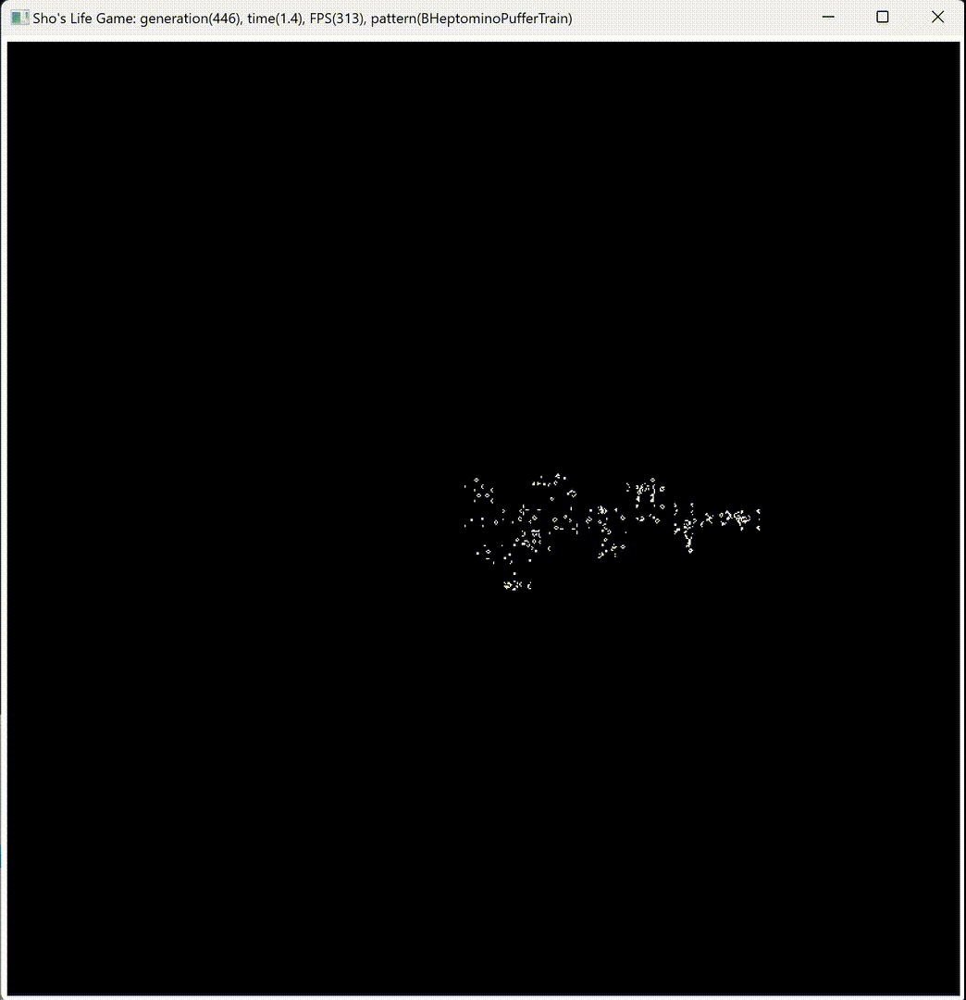
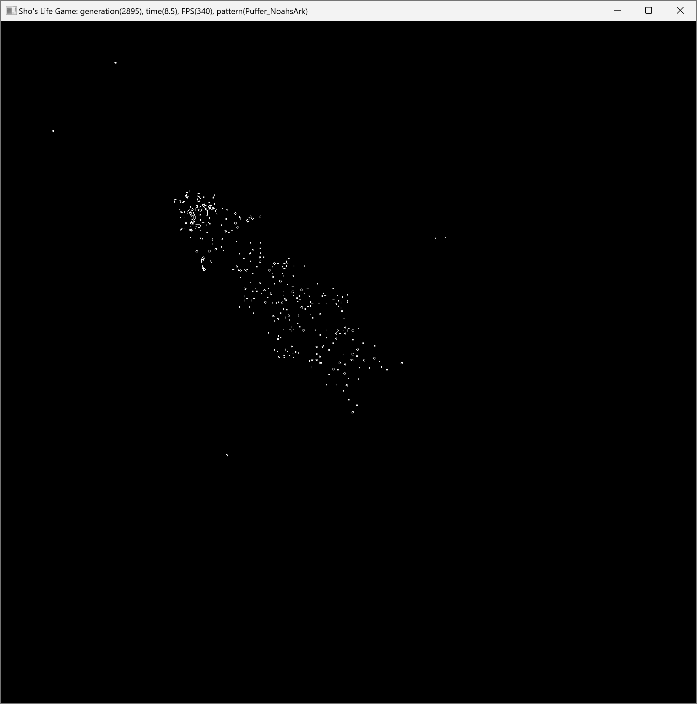

# Shos.LifeGame

[English](README.md) | [日本語](README.jp.md)



[](https://youtu.be/ny-VKZEAVkg)

**C++20 と Win32 API だけで書いた高速な[ライフゲーム](https://ja.wikipedia.org/wiki/%E3%83%A9%E3%82%A4%E3%83%95%E3%82%B2%E3%83%BC%E3%83%A0) (B3/S23)。**

このリポジトリーは、最適化を学ぶための教材でもある。最適化の要素はそれぞれ `#define` で切り替えられるので、要素ごとにどれだけ速くなるかを測って比べられる。コードの解説は、日本語の記事 ([Articles(Japanese)/ShosLifeGame_Article.md](Articles(Japanese)/ShosLifeGame_Article.md)) にある。

## 特徴

- **4 つの最適化で約 15 倍速くなる**: 1000×1000 の盤面で、毎秒 16 世代から 244 世代になる ([ベンチマーク](#ベンチマーク)を参照)。
- **最適化の要素は `#define` 1 つずつで切り替えられる**: コメントにしてビルドし直せば、タイトルバーの FPS で効果を比べられる。
- **盤面を変換せずに描画する**: 盤面のビット列を、そのまま 1bpp のビットマップとして `BitBlt` で描画する。
- **外部ライブラリーを使わない**: 使うのは C++20 の標準ライブラリーと Win32 API だけである。
- **16 通りの組み合わせをすべてテストする**: 回帰テストは、4 つの `#define` のすべての組み合わせを Linux/WSL でビルドして実行する。GitHub Actions でも同じテストを実行する。
- **有名なパターンを 46 個同梱している**: グライダー銃、宇宙船、パファー、メトセラなどを、Life 1.05 形式と RLE 形式で収録している。

## 最適化の要素

[Shos.LifeGame/ShosLifeGame.h](Shos.LifeGame/ShosLifeGame.h) の冒頭にある 4 つの `#define` が、最適化の中心である。初期状態では、4 つとも定義されている。

```cpp
#define USEBITS // Bits enabled           : a cell is stored in one bit (otherwise in one bool).
#define FAST    // Fast loops enabled     : direct loops instead of generic loops with std::function.
#define MT      // Multi-threading enabled: the rows are split among threads.
#define AREA    // Area enabled           : only the active area of the board is computed.
```

| `#define` | 内容 | トレードオフ |
|---|---|---|
| `USEBITS` | 1 セルを 1 ビットで持つ (`BitCellSet`)。未定義の場合は、行ごとの `bool` 配列で持つ。 | ビット演算のコードは、`bool` 配列より読みにくい。 |
| `FAST` | `std::function` を使う汎用ループ (`Utility::ForEach`) の代わりに、直接のループを使う。次の世代は行単位で計算し (`Game::NextRow`)、縦 3 セルの合計を隣のセルと共有する。 | 似たコードが重複する。 |
| `MT` | 行 (Y 方向) を `ThreadPool` のスレッドに分け、スレッドごとに `NextPart` を実行する。スレッドはゲームの間ずっと残しておき、範囲が小さいときは少ないスレッドで計算する。 | 小さい盤面では効果が出にくい。 |
| `AREA` | 活動範囲 (生きているセルの外接矩形に周囲 1 マスを加えた範囲) だけを計算する。 | 範囲の管理が複雑になる。セルが盤面全体に広がると効果が小さい。 |

この 4 つとは別に、`BoardPainter` ([Shos.LifeGame/ShosLifeGameBoardPainter.h](Shos.LifeGame/ShosLifeGameBoardPainter.h)) が描画を最適化している。`USEBITS` が定義されている場合、`BoardPainter` は盤面のビット列をそのまま `SetBitmapBits` でビットマップに書き込み、`BitBlt` で描画する。ビットマップは 1 回だけ作り、使い回す。これができるのは、`BitCellSet` のビット配置を 1bpp のビットマップに合わせてあるからである。各バイトの最上位ビットを左端のピクセルにし、1 行のバイト数を WORD 境界にそろえている。

## ベンチマーク

各レベルは、前のレベルに最適化の要素を 1 つずつ加えたものである。

| レベル | `USEBITS` | `FAST` | `MT` | `AREA` | 実行時間 | 世代/秒 | 倍率 |
|---:|:---:|:---:|:---:|:---:|---:|---:|---:|
| 0 | 未定義 | 未定義 | 未定義 | 未定義 | 63.8 秒 | 16 | 1.00 |
| 1 | 定義 | 未定義 | 未定義 | 未定義 | 60.2 秒 | 17 | 1.06 |
| 2 | 定義 | 定義 | 未定義 | 未定義 | 24.2 秒 | 41 | 2.56 |
| 3 | 定義 | 定義 | 定義 | 未定義 | 11.7 秒 | 86 | 5.38 |
| 4 | 定義 | 定義 | 定義 | 定義 | 4.1 秒 | 244 | 15.25 |

- 測定条件: パターン `Gun_Gunstar`、盤面 1000×1000、1000 世代、Release ビルド。
- 測定環境: DELL XPS 13 9310、11th Gen Intel Core i7 2.92GHz (4 コア、8 論理プロセッサー)、メモリー 16GB、Windows 11。
- 結果は、CPU、ビルド設定、パターンによって変わる。たとえばランダムな盤面では、活動範囲が盤面全体になるので、`AREA` の効果は小さい。

測定データは [Articles(Japanese)/ShosLifeGame_BenchmarkData.csv](Articles(Japanese)/ShosLifeGame_BenchmarkData.csv) にある。

## ビルドと実行

必要なもの: Windows、C++ によるデスクトップ開発のワークロードを入れた Visual Studio (プラットフォーム ツールセット v145、C++20)。

1. Visual Studio で `Shos.LifeGame.sln` を開く。
2. `Release` と `x64` を選んでビルドする。ビルド後のイベントで、`CellData` フォルダーが出力先にコピーされる。
3. `Shos.LifeGame` を実行する。

最適化の効果を比べるには、`ShosLifeGame.h` の `#define` のいくつかをコメントにしてビルドし直し、タイトルバーの FPS を見る。`Shos.LifeGame.cpp` の `#define LAP_TIMES 1000` のコメントを外すと、タイトルバーには 1000 世代の時点の値が表示され続ける。これはベンチマークの測定条件と同じである。

## 使い方

| 操作 | 動作 |
|---|---|
| `0`–`9`、`a`–`z`、`A`–`J` | `CellData` のパターンを読み込む |
| それ以外のキー (`K`–`Z` など) | 盤面をランダムに埋める |
| 右クリック | 盤面をランダムに埋める |

- 盤面は 1000×1000 セルである。盤面の外のセルは常に死んでいる (盤面はトーラスではない)。
- タイトルバーには、世代、経過時間、FPS (1 秒あたりの世代数)、パターン名が表示される。
- メッセージキューが空になるたびに 1 世代を進める。そのため CPU を 1 コア使い続けるが、これは最大の FPS を測るための意図した動作である。

## パターンファイル

パターンファイルは、実行ファイルと同じ場所にある `CellData` フォルダーから読み込む。対応している形式は次の 2 つである (拡張子の大文字と小文字は区別しない)。

- [Life 1.05](https://conwaylife.com/wiki/Life_1.05) (`.lif`/`.life`): `#` 行と `!` で始まるコメント行は読み飛ばす。`#P x y` によるブロックの配置に対応している。
- [RLE](https://conwaylife.com/wiki/Run_Length_Encoded) (`.rle`): ヘッダーの `rule` は無視する (常に B3/S23 を使う)。

ファイルは、Life 1.05 形式が先、RLE 形式が後の順に並べる。それぞれの中では、ファイル名を大文字と小文字を区別せずに並べる。この並び順に、キー `0`–`9`、`a`–`z`、`A`–`J` が割り当てられる。ファイルを追加したり名前を変えたりすると、キーの割り当てがずれる。

## テスト

[Shos.LifeGame.Test/Shos.LifeGame.RegressionTest.cpp](Shos.LifeGame.Test/Shos.LifeGame.RegressionTest.cpp) には、シミュレーション、活動範囲、ビットマップのビット配置、パターンファイルの読み込みの回帰テストがある。シミュレーションの結果は、単純な参照実装と比べて検証する。次のスクリプトは、`USEBITS`/`FAST`/`MT`/`AREA` の 16 通りの組み合わせすべてを、Linux または WSL の g++ でビルドして実行する。GitHub Actions も同じスクリプトを実行する ([.github/workflows/regression-tests.yml](.github/workflows/regression-tests.yml))。

```
./Shos.LifeGame.Test/run_regression_tests.sh          # すべての組み合わせ (約 2 分)
./Shos.LifeGame.Test/run_regression_tests.sh --asan   # AddressSanitizer と UndefinedBehaviorSanitizer 付き
```

[Shos.LifeGame.Test/Shos.LifeGame.Benchmark.cpp](Shos.LifeGame.Test/Shos.LifeGame.Benchmark.cpp) は、ウィンドウを使わずに `Game::Next` の速さを測る。次のスクリプトは、これを `-O2` でビルドし、組み合わせを 1 つずつ実行する。各ケースは 3 回実行し、最も速い値を表示する。

```
./Shos.LifeGame.Test/run_benchmark.sh                        # すべての組み合わせ
./Shos.LifeGame.Test/run_benchmark.sh --scale 0.1 FAST_MT_AREA USEBITS_FAST_MT_AREA   # 世代数を減らし、一部の組み合わせだけ
```

`Shos.LifeGame.Test/Shos.LifeGame.Test.cpp` (Visual Studio のテストプロジェクト) はベンチマークであり、結果の正しさは検証しない。

## フォルダー構成

```
Shos.LifeGame/                 アプリケーション
  ShosLifeGame.h               ゲームのロジック、盤面、パターン、最適化 (プラットフォームに依存しない)
  ShosLifeGameBoardPainter.h   盤面の描画 (Win32 GDI)
  ShosWin32.h                  ウィンドウとメッセージループの小さなフレームワーク
  ShosHelper.h                 コレクション、ファイル、文字列のヘルパー
  ShosStopwatch.h              ストップウォッチ
  Shos.LifeGame.cpp            メインウィンドウとエントリーポイント
  CellData/                    パターンファイル (.lif/.rle)
Shos.LifeGame.Test/            回帰テストとベンチマーク (g++)、ベンチマーク (Visual Studio)
Articles(Japanese)/            日本語の記事、図、ベンチマークのデータ
Images/                        スクリーンショットとアニメーション
```

## プログラムの構成

### namespace Shos::LifeGame (`ShosLifeGame.h`)

- `Random`: `std::random_device` と `std::mt19937` で乱数を作る。
- `Size`、`Point`、`Rect`: 盤面上の大きさ、座標、矩形を表す。
- `Utility`: 矩形内の各点を回す汎用ループ (`FAST` が未定義のときに使う)。
- `ThreadPool`: ゲームの間ずっと残しておくスレッドで、整数の範囲を分けて処理する (`MT` が定義されているときに使う)。
- `Pattern`、`PatternSet`: 初期パターンを表し、Life 1.05 形式と RLE 形式のファイルから読み込む。
- `BitCellSet`: 1 セルを 1 ビットで持つセルの集合。ビット配置は 1bpp のビットマップに合わせてある。
- `Board`: 盤面。`USEBITS` が定義されていれば `BitCellSet` を継承し、未定義なら行ごとの `bool` 配列を使う。
- `Game`: 現在の盤面から次の世代を計算し、活動範囲を管理する。

### namespace Shos::LifeGame::Win32 (`ShosLifeGameBoardPainter.h`)

- `BoardPainter`: 盤面をデバイスコンテキストに描画する。描画の最適化も受け持つ。

### namespace Shos::LifeGame::Application (`Shos.LifeGame.cpp`)

- `MainWindow`: メインウィンドウ。キーとマウスの操作を受け付け、盤面と FPS を表示する。
- `Program`: メインウィンドウを作り、メッセージループを実行する。

### namespace Shos::Win32 (`ShosWin32.h`)

- `Window`: ウィンドウの基底クラス。メッセージを仮想関数 `On...` に振り分ける。
- `Program`: アプリケーションの基底クラス。メッセージループを実行する。

### namespace Shos (`ShosHelper.h`、`ShosStopwatch.h`)

- `Helper`: コレクション用の汎用ヘルパー (`ForEach`、`Map`、`Filter`、`Maximum`、`Connect`)。
- `File`: フォルダー内のファイルの一覧を取得し、テキストファイルを読み込む。
- `String`: 文字列のトリム、パディング、分割、小文字への変換を行う。
- `stopwatch`: `std::chrono::steady_clock` で時間を測る。

## 解説記事

- [C++/Win32で学ぶ高速ライフゲーム実装: Shos.LifeGame徹底解説](Articles(Japanese)/ShosLifeGame_Article.md)

ライフゲームのルール、パターンファイルの形式、データ構造、最適化の各要素、ベンチマークを、図を使って解説している。

## 作者

小島 富治雄 (Fujio Kojima): 日本のソフトウェア開発者
* Microsoft MVP for Development Tools - Visual C# (2005 年 7 月 - 2014 年 12 月)
* Microsoft MVP for .NET (2015 年 1 月 - 2015 年 10 月)
* Microsoft MVP for Visual Studio and Development Technologies (2015 年 11 月 - 2018 年 6 月)
* Microsoft MVP for Developer Technologies (2018 年 11 月 - 2026 年 6 月)
* [MVP Profile](https://mvp.microsoft.com/en-US/mvp/profile/4185d172-3c9a-e411-93f2-9cb65495d3c4 "MVP Profile")
* [ブログ](http://wp.shos.info "ブログ")
* [Web サイト](http://www.shos.info "Web サイト")
* [Twitter](https://twitter.com/Fujiwo)
* [Instagram](https://www.instagram.com/fujiwo/)

## ライセンス

このプロジェクトは MIT License で公開している。詳しくは [LICENSE.txt](LICENSE.txt) を参照。
